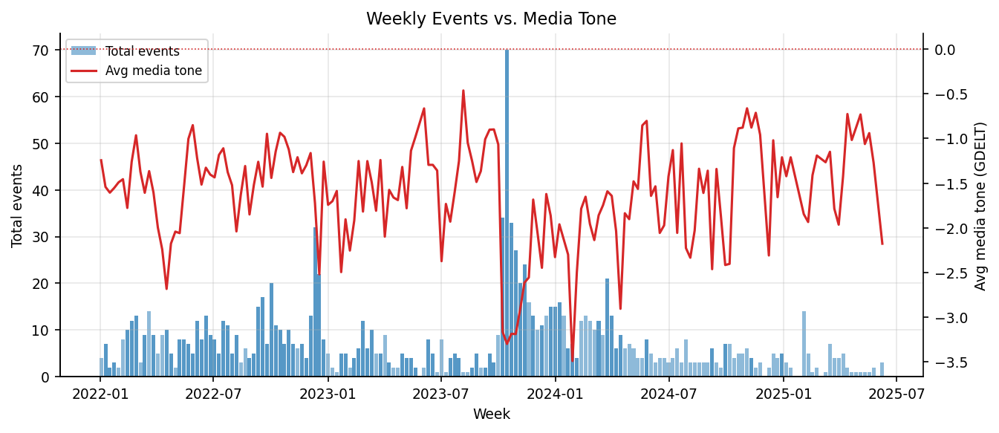
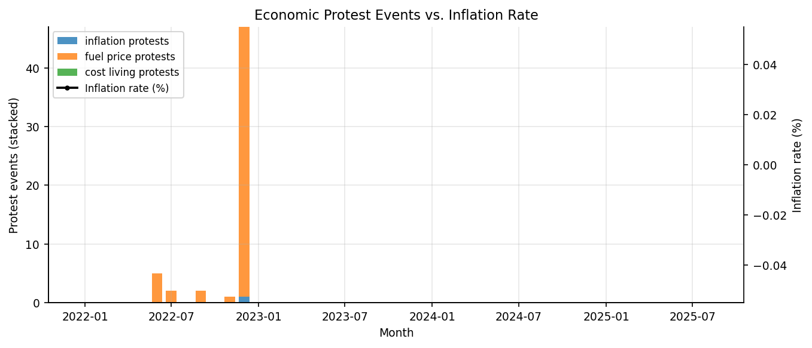
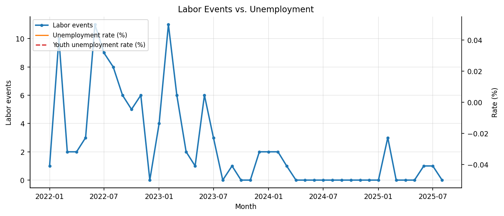
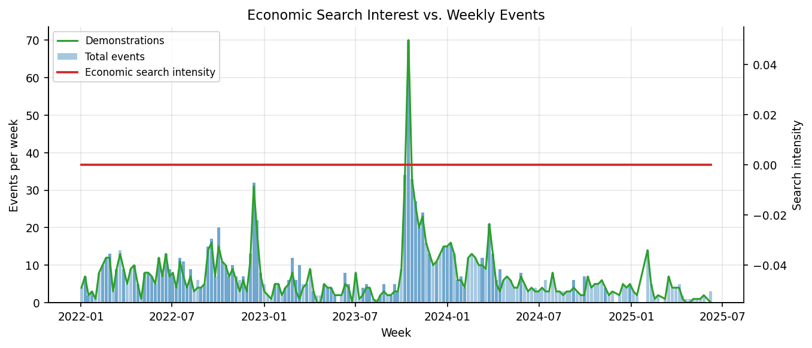
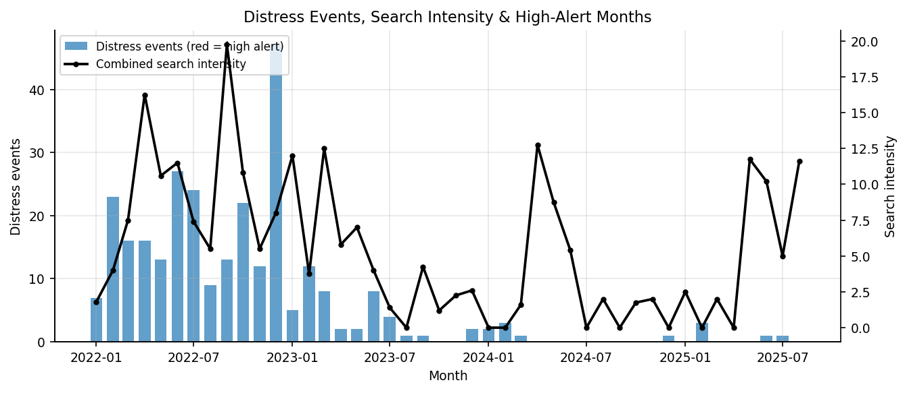

# Jordan Information Environment Project

## The question

**Does economic hardship drive protests in Jordan, or do protests, media attention, and public searches drive economic outcomes?** We integrated conflict events (ACLED), Google search trends, media coverage (GDELT), and World Bank economic indicators (2021-2025) to find out.

**The answer:** Protests, media coverage, and public searches form a **bidirectional feedback loop** with inflation — events appear to drive inflation at least as strongly as inflation drives events (r = 0.765 vs. r = 0.584), and this only becomes visible when protests are split by theme (economic vs. political) and analyzed monthly rather than mixed together quarterly. Full detail and caveats in [FINDINGS.md](FINDINGS.md).

## Pipeline

```
Bronze (raw ingestion)  →  Silver (cleaned, dbt)  →  Gold (thematic, monthly, ML-ready)
   ACLED, GDELT,              standardized schemas,       theme_labor_employment
   Google Trends,             AI enrichments,             theme_economic_conditions
   World Bank,                deduplication                ml_combined_economic_themes
   geoBoundaries
```

- **Bronze**: Delta tables, minimal transformation (`info_env_jordan.bronze`)
- **Silver**: dbt models in `models/silver/` (`info_env_jordan.silver`)
- **Gold**: dbt models in `models/gold/`, monthly/country-level, policy-themed (`info_env_jordan.gold`)

## Key findings

1. **Bidirectional feedback between events, searches, and media** — protests drive media coverage and searches, and searches/media also predict future protests (events ↔ media r = 0.66; searches lead events by ~1 week).
2. **Economic protests predict inflation, not just the reverse** — events → inflation (r = 0.765, p < .001) is stronger than inflation → events (r = 0.584, p < .001), suggesting a self-reinforcing inflationary spiral rather than hardship as the sole driver.
3. **Youth unemployment negatively correlates with protests** (r = -0.42) — contradicting the "frustrated youth" hypothesis; protests track policy trigger events (subsidy cuts, corruption) more than unemployment levels.

See [FINDINGS.md](FINDINGS.md) for evidence, methodology, and limitations.

## Gold layer visualizations

Top 5 charts from the `info_env_jordan.gold` tables (Jan 2022 – Aug 2025), generated by the `analysis/Gold Layer Visuals` notebook into `analysis/visualals/` — re-run the notebook to regenerate.



*Weekly ACLED event volume vs. average GDELT media tone — event spikes coincide with more negative coverage.*



*Stacked economic protest events (inflation, fuel price, cost of living) vs. the inflation rate.*



*Monthly labor events alongside overall and youth unemployment rates.*



*Economic search interest vs. weekly events and demonstrations — attention builds ahead of protest activity.*



*Combined economic + labor distress events with search intensity; red bars mark high-alert flag months (none triggered in the current data window).*

## Stack & dbt tests

- **Platform**: Databricks on AWS, Delta Lake (Unity Catalog), Apache Spark
- **Transformation**: dbt, Python, SQL
- **Tests**: 21 dbt data quality checks (not-null, uniqueness, value ranges, accepted values, freshness) plus a singular end-to-end test validating the full Bronze → Silver → Gold pipeline:
  ```bash
  dbt test --select test_end_to_end_pipeline
  dbt test   # run all 21 checks
  ```
  See [tests/README_TESTS.md](tests/README_TESTS.md) for details.

## How to run it

1. **Prerequisites**: Databricks workspace access and permissions on the `info_env_jordan` catalog. API keys for SerpAPI (Google Trends) and ACLED are required — see [SETUP.md](SETUP.md) for credential and dbt CLI setup.
2. **Ingest bronze data**: run the `bronze/01_ingest_*` notebooks.
3. **Transform to silver/gold**: run dbt via the `run_dbt` notebook, or manually (see [SETUP.md](SETUP.md) for CLI commands).
4. **Analyze**: explore results in `analysis/` notebooks, starting with *Jordan Information Environment - Comprehensive Analysis*.

For project structure, data source details, table catalog, and theme-to-policy mapping, see [DATA_DICTIONARY.md](DATA_DICTIONARY.md).

---

**Last Updated**: November 2026 · **Maintainer**: feliciapedwards@gmail.com · **License**: MIT ([LICENSE](LICENSE))
